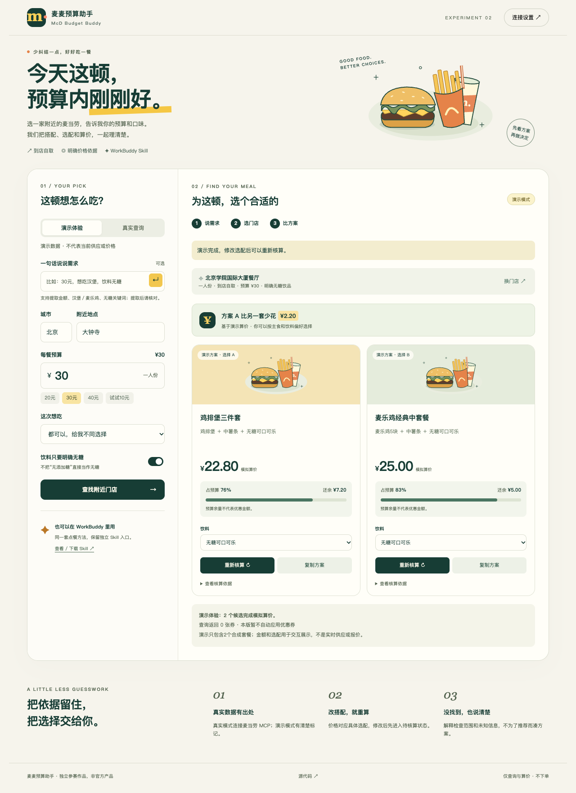

# 麦麦预算助手 · McD Budget Buddy

手机优先点餐网页 + 可独立使用的 WorkBuddy Skill。按地点、预算和饮食偏好，比较最多两套到店自取方案；修改具体饮料后重新核价。



## 开始体验网页

需要 Node.js 22+，在仓库根目录运行：

```bash
npm ci
npm run start:workbuddy
```

以后可双击项目里的 **启动麦麦助手.command**。保持启动终端运行；重复启动会提示已有服务，不会再占用同一端口。

打开 http://127.0.0.1:4310 。默认演示模式，无需账号，使用明确标注的合成数据。演示金额不代表实时价格，插画不代表实际商品照片。

### 真实模式

1. 从 [麦当劳 MCP 控制台](https://open.mcd.cn/mcp)获取自己的 Token。
2. 复制 `.env.example` 为 `.env`，在本地填写 `MCD_MCP_TOKEN`。
3. 重启 `npm start`，在页面选择“真实查询”。

如果你已经在这台 Mac 的 WorkBuddy 中配置 mcd-mcp，也可运行 `npm run start:workbuddy`；程序只读取该配置里的认证信息，仍不保存 Token。

Token 只在后端内存使用，不通过网页填写，不返回到浏览器。不要提交 .env、真实配置或认证日志。默认仅监听电脑本地地址；已验证390px手机布局，但手机真机不能直接访问电脑的localhost。受控远程访问另行配置。

## 网页能做什么

- 查询门店，由用户选择，隐藏业务编码。
- 提取金额、汉堡/麦乐鸡、无糖等有限关键词；用户可手动修改条件。网页未使用 LLM。
- 实时查询菜单与券、读取套餐选配、用 calculate-price 核算完整具体方案。
- 使用整数分判断预算；显示预算占用、余量和两方案价差，修改饮料立即使旧价格失效。
- 手机生成后收起条件，结果卡片支持重新选配、核算和复制。
- 无方案和接口失败有明确提示，不把有限搜索称为全店最低价或全店无解。
- 演示与真实模式隔离，只有接口核价才显示真实核算标签。

当前仅单人、单门店、当前到店自取，最多8个套餐候选。优惠券仅查询、不自动应用；不执行下单、领券、积分兑换。其他限制见 [验证说明](docs/WEB_VALIDATION.md)。

## WorkBuddy 独立入口

```bash
npm run skill:pack
```

生成 `releases/mcd-budget-buddy-skill.zip`，内含 `mcd-budget-buddy/` 顶层文件夹。通过 WorkBuddy 的本地 Skill 导入入口加载（入口以当前客户端版本为准），并在 WorkBuddy 中按 [官方指南](https://github.com/M-China/mcd-mcp-server)接好 MCP。

也可在解压目录中要求 WorkBuddy：“读取当前目录 SKILL.md，使用麦麦预算助手。我在大钟寺附近，预算30元，只接受明确无糖饮品，先让我选择门店。”

保留 shared、scripts、examples 文件夹。Skill 与网页共用 shared/policy.json 的工具范围、场景及无糖标注规则，但不依赖网页服务；网页执行代码不会自动执行 Markdown。

## 验证

```bash
npm test
python3 -m unittest discover -s tests -p 'test*.py' -v
python3 scripts/check_plan.py examples/plan.json
```

自动化覆盖金额单位、具体选配、预算不足、业务错误、演示完整接口流程及本地同源限制。浏览器检查覆盖选店、方案生成、修改后的待核算与重新核价、低预算无方案、手机宽度和可访问性。

历史 WorkBuddy 文件注明来源与日期；真实网页验证状态见 [验证说明](docs/WEB_VALIDATION.md)。历史测试价格不代表当前价格。

## 参赛进度

- [x] 网页、独立 Skill、MCP 集成说明及本地验证
- [x] 官方参赛声明原文与脱敏配置
- [ ] 整理真实 WorkBuddy 开发记录 workbuddy.md（申请专项奖励时需要）
- [ ] 录制真实使用演示
- [ ] 官方 Issue 报名并确认成功

[参考项目](docs/REFERENCES.md) · [产品范围](docs/PRODUCT.md) · [MCP 集成](MCP_INTEGRATION.md) · [赛事规则](https://github.com/M-China/mcd-developer-innovation-challenge/blob/main/activityGuidelines.md)

本项目为独立开发的参赛作品，不代表麦当劳或腾讯官方产品。引用的官方参赛声明和第三方依赖适用其自身条款；原创实现使用 MIT 许可。

## 连接故障处理

页面报服务离线时，先启动项目，再点击“重新连接”。页面会定期检查本地服务是否仍在运行。无 Token、麦当劳认证错误、业务失败和请求超时分别提示；不会把接口失败描述成预算内无方案。

这仍是本地应用，关闭启动终端或重启电脑后，需要再次启动。网页缓存本身不能提供后端能力。
