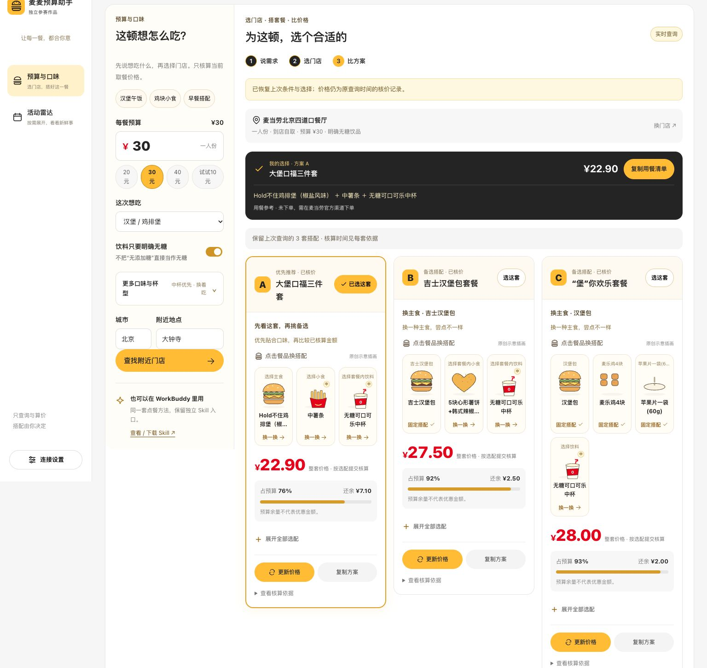

# 麦麦预算助手 · McD Budget Buddy

以预算与口味为中心的点餐网页 + 独立 WorkBuddy Skill。最多给出 A/B/C 三套具体搭配，每套实时核价；活动雷达按需展开，也支持同款跨店比较。



[新版搭配优先工作台](docs/meal-first-desktop.png) · [修改条件保留方案](docs/conditions-retained.png) · [单滚动工作台](docs/single-scroll.png) · [三方案工作台](docs/meal-focus-desktop.png) · [中杯与大杯](docs/cup-sizes.png) · [手机搭配界面](docs/meal-first-mobile.png) · [图形选配弹窗](docs/meal-editor.png) · [早餐形态对应](docs/breakfast-shapes.png) · [活动雷达](docs/ui-mobile.png)

## 启动真实查询网页

需要 Node.js 22+，在仓库根目录运行：

```bash
npm ci
npm run start:workbuddy
```

以后可双击项目里的 **启动麦麦助手.command**。保持启动终端运行；重复启动会提示已有服务，不会再占用同一端口。

打开 http://127.0.0.1:4318 。网页只提供真实查询，需先配置麦当劳 MCP。未配置或接口失败会明确提示，不会填入合成活动或套餐价格。餐品插画是界面示意，不代表实际商品照片。

### 连接麦当劳 MCP

1. 从 [麦当劳 MCP 控制台](https://open.mcd.cn/mcp)获取自己的 Token。
2. 复制 `.env.example` 为 `.env`，在本地填写 `MCD_MCP_TOKEN`。
3. 重启 `npm start`，页面直接使用真实查询。

如果你已经在这台 Mac 的 WorkBuddy 中配置 mcd-mcp，也可运行 `npm run start:workbuddy`；程序只读取该配置里的认证信息，仍不保存 Token。

Token 只在后端内存使用，不通过网页填写，不返回到浏览器。不要提交 .env、真实配置或认证日志。默认仅监听电脑本地地址；已验证390px手机布局，但手机真机不能直接访问电脑的localhost。受控远程访问另行配置。

## 网页能做什么

- 桌面左侧导航，手机侧滑导航；预算搭配优先，活动雷达默认收起，首次展开才查询。
- 午饭、小食、早餐快捷偏好；支持省预算/换着吃、口味倾向与中杯/大杯优先。口味按名称匹配，实际辣度未知；杯型缺少匹配时说明。
- 常用条件直接显示，口味/杯型与提取需求默认折叠；折叠标题显示当前偏好。
- 餐品卡片先出现，价格图默认折叠到搭配后面；备选注明实际主食/小食差异。
- 修改预算和偏好保留原方案与选中项为参考，明确上次预算和核价，并停用选配/复制/比较；支持恢复上次条件或直接按新条件生成。
- 选中后显示完整用餐清单与杯型，明确未下单。
- A 优先推荐，B/C 备选；主食或小食不同才算不同搭配，数量不足时如实展示。每套提交完整选配独立核价。
- 中杯、大杯插画有尺寸差异和杯型角标，切换后重新核价。

- 活动雷达：实时查询活动日历与可领券，查看日期、官方海报和原文详情；本地收藏不触发官方订阅。
- 时间探索：只按明确的券使用日期、星期与时间段判断；缺少时段时保留未知，不猜每天供应时间。
- 同款跨店比价：两店分别核算相同商品与完整选配；查不到同款时明确停止，不自动换商品。
- 活动支持关键词搜索、早餐/新品/联名筛选、大海报与详情弹窗；收藏用轻提示反馈。
- 详情可进入预算搭配，保留预算和偏好；活动仅作参考，不自动匹配优惠。
- 时间设置可折叠并快捷选择早餐/午餐/晚餐；更新时保留所选日期与时间。
- 互动汉堡、日期胶囊、卡片反馈；尊重系统减少动态效果的设置。

- 查询门店，由用户选择，隐藏业务编码。
- 提取金额、汉堡/麦乐鸡、无糖等有限关键词；用户可手动修改条件。网页未使用 LLM。
- 实时查询菜单与券、读取套餐选配、用 calculate-price 核算完整具体方案。
- 使用整数分判断预算；显示预算占用、余量和三方案价差，修改饮料立即使旧价格失效。
- 手机生成后收起条件，结果卡片支持重新选配、核算和复制。
- 套餐以可点击的餐品托盘展示；薯饼、油条、香肠、麦满分、不同汉堡、薯条、鸡翅、鸡块及常见饮品各有原创形态示意。点选后从实时详情里的真实选项换搭配并核算。
- 悬停或键盘聚焦时，汉堡分层飞起回落、薯条错峰跳起、杯盖与吸管浮起；触屏有点按反馈，并尊重减少动态效果设置。
- 长选项列表支持搜索；更换前显示原餐品与新餐品。未核算修改可撤销，恢复上次实际核价记录与原查询时间。未知新品使用中性图示，不冒充其他餐品。
- 三方案与同款跨店核价使用从0开始的横向价格图，显示预算虚线；不拆造套餐子项价格。
- “选这套”保留明确选中状态和复制入口；固定搭配与可替换项分别标注。
- 预算条件和结果使用整个页面的一个纵向滚动区，没有条件栏内部滚动条。
- 按钮立即显示进行中的动作，展开收起可快速反向操作，结果有短入场反馈；尊重减少动态效果设置。
- 连接检查区分暂未确认、超时、离线与版本不匹配；检查去重，过期失败不会覆盖新查询成功。
- 查询有骨架、等待动画与实际耗时；错误可重试。海报有加载状态、淡入及失败后的详情和重试入口。
- 本地只记住预算、口味与无糖偏好；刷新不恢复历史报价或自动选择门店。键盘导航与减少动态效果均保留。
- 无方案和接口失败有明确提示，不把有限搜索称为全店最低价或全店无解。
- 前后端仅允许真实查询；旧的体验模式请求会被拒绝，不以历史示例补充失败结果。

当前仅单人、单门店、当前到店自取，最多12个套餐候选、18份具体搭配核价，返回最多3套不同方案。优惠券仅查询、不自动应用；不执行下单、领券、积分兑换。其他限制见 [验证说明](docs/WEB_VALIDATION.md)。

## WorkBuddy 独立入口

```bash
npm run skill:pack
```

生成 `releases/mcd-budget-buddy-skill.zip`，内含 `mcd-budget-buddy/` 顶层文件夹。通过 WorkBuddy 的本地 Skill 导入入口加载（入口以当前客户端版本为准），并在 WorkBuddy 中按 [官方指南](https://github.com/M-China/mcd-mcp-server)接好 MCP。

也可在解压目录中要求 WorkBuddy：“读取当前目录 SKILL.md，使用麦麦预算助手。我在大钟寺附近，预算30元，只接受明确无糖饮品，先让我选择门店。”

保留 shared、scripts、examples 文件夹。Skill 与网页共用 shared/policy.json 的工具范围、场景及无糖标注规则，但不依赖网页服务；网页执行代码不会自动执行 Markdown。

## 验证

```bash
npm test
python3 -m unittest discover -s tests -p 'test*.py' -v
python3 scripts/check_plan.py examples/plan.json
```

自动化覆盖金额单位、具体选配、预算不足、业务错误、同款比价、未配置连接、禁用合成数据及本地同源限制。新版浏览器检查覆盖真实活动、选店、方案生成、选配修改与重算、门店比价及手机布局；各轮验证范围见验证说明。

历史 WorkBuddy 文件注明来源与日期；真实网页验证状态见 [验证说明](docs/WEB_VALIDATION.md)。历史测试价格不代表当前价格。

## 参赛进度

- [x] 网页、独立 Skill、MCP 集成说明及本地验证
- [x] 官方参赛声明原文与脱敏配置
- [ ] 整理真实 WorkBuddy 开发记录 workbuddy.md（申请专项奖励时需要）
- [ ] 录制真实使用演示
- [ ] 官方 Issue 报名并确认成功

[参考项目](docs/REFERENCES.md) · [产品范围](docs/PRODUCT.md) · [MCP 集成](MCP_INTEGRATION.md) · [赛事规则](https://github.com/M-China/mcd-developer-innovation-challenge/blob/main/activityGuidelines.md)

本项目为独立开发的参赛作品，不代表麦当劳或腾讯官方产品。引用的官方参赛声明和第三方依赖适用其自身条款；原创实现使用 MIT 许可。

## 连接故障处理

页面报服务离线时，先启动项目，再点击“重新连接”。页面会定期检查本地服务是否仍在运行。无 Token、麦当劳认证错误、业务失败和请求超时分别提示；不会把接口失败描述成预算内无方案。

这仍是本地应用，关闭启动终端或重启电脑后，需要再次启动。网页缓存本身不能提供后端能力。

## 本次本地体验地址

开发试用新版运行在 http://127.0.0.1:4318/ 。新启动默认使用4318，与当前页面保持一致；设置了 PORT 或 .env 时以启动终端显示的地址为准。

活动海报由 MCP 返回的公开麦当劳 CDN 链接直接加载，没有抓取或复制第三方项目素材。海报与活动文案的权利属于其原作者；本项目 MIT 授权不覆盖这些官方内容。
